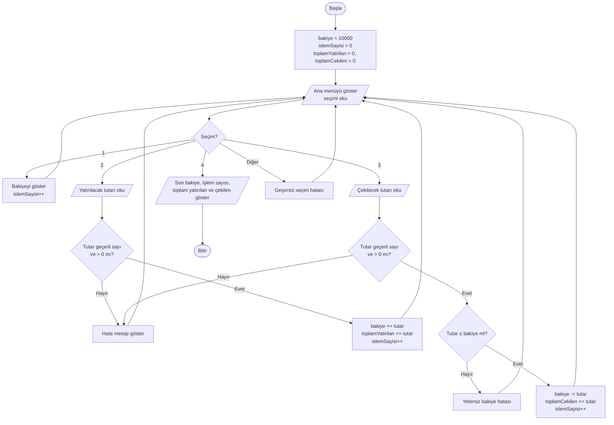

# Akıllı ATM ve Bankacılık Simülasyonu

Bir bankanın ATM sistemini simüle eden Java konsol programı. Program, kullanıcı **Çıkış** seçeneğini seçene kadar sürekli çalışır ve işlem almaya devam eder.

## Özellikler

- Başlangıç bakiyesi **10.000 TL**
- Menü: 1) Bakiye görüntüleme 2) Para yatırma 3) Para çekme 4) Çıkış
- Negatif / sıfır / sayı olmayan tutarlar reddedilir
- Para çekmede bakiye kontrolü yapılır, yetersizse işlem gerçekleşmez
- Geçersiz menü seçiminde hata mesajı gösterilir
- Her işlemden sonra ana menü tekrar gösterilir
- **Ek:** toplam işlem sayısı, toplam yatırılan ve toplam çekilen tutar tutulur; çıkışta son bakiye ve işlem sayısı gösterilir
- Tutarlar tam sayı (TL) olarak girilir (ör. `2500`)

Kısıta uygun olarak yalnızca **döngü** (`while`) ve **karar yapıları** (`if / else if / else`) kullanılmıştır, dizi kullanılmamıştır.

## Çalıştırma

```bash
javac -d out src/ATM.java
java -cp out ATM
```

## Algoritma Açıklaması

1. **Başla.** `bakiye = 10000`, `islemSayisi = 0`, `toplamYatirilan = 0`, `toplamCekilen = 0`, `devam = true` olarak ayarla.
2. `devam` doğru olduğu sürece tekrarla:
   1. Ana menüyü ekrana yazdır ve kullanıcının seçimini oku.
   2. **Seçim = 1 (Bakiye):** Bakiyeyi göster, `islemSayisi`'ni 1 artır.
   3. **Seçim = 2 (Yatırma):** Tutarı oku.
      - Tutar sayı değilse → "Geçerli bir sayı giriniz" hatası.
      - Tutar ≤ 0 ise → "Negatif veya sıfır tutar yatırılamaz" hatası.
      - Aksi halde → `bakiye += tutar`, `toplamYatirilan += tutar`, `islemSayisi++`, yeni bakiyeyi göster.
   4. **Seçim = 3 (Çekme):** Tutarı oku.
      - Tutar sayı değilse → hata.
      - Tutar ≤ 0 ise → hata.
      - Tutar > bakiye ise → "Yetersiz bakiye" hatası, işlem yapılmaz.
      - Aksi halde → `bakiye -= tutar`, `toplamCekilen += tutar`, `islemSayisi++`, yeni bakiyeyi göster.
   5. **Seçim = 4 (Çıkış):** `devam = false`.
   6. **Diğer her seçim:** "Geçersiz seçim" hata mesajı göster.
   7. Döngü başa döner → menü tekrar gösterilir.
3. Döngüden çıkınca **işlem özetini** yazdır: son bakiye, toplam işlem sayısı, toplam yatırılan, toplam çekilen.
4. **Bitir.**

> Not: İşlem sayısına yalnızca **başarılı** işlemler (bakiye görüntüleme, başarılı yatırma, başarılı çekme) sayılır. Hatalı girişler ve çıkış sayılmaz.

## Akış Şeması



## Test Senaryoları

Her senaryonun girdisi `tests/` klasöründedir. Çalıştırmak için:

```bash
java -cp out ATM < tests/t1_bakiye.txt
```

| # | Senaryo | Girdi (sırayla) | Beklenen Sonuç | Sonuç |
|---|---------|-----------------|----------------|-------|
| 1 | Bakiye görüntüleme | `1`, `4` | Bakiye 10.000 TL; işlem sayısı 1 | ✅ |
| 2 | Geçerli para yatırma | `2`, `2500`, `1`, `4` | Yeni bakiye 12.500 TL; toplam yatırılan 2.500; işlem sayısı 2 | ✅ |
| 3 | Negatif ve sıfır yatırma | `2`, `-500`, `2`, `0`, `4` | İki kez "Negatif veya sıfır tutar yatırılamaz"; bakiye değişmez; işlem sayısı 0 | ✅ |
| 4 | Geçerli para çekme | `3`, `3000`, `1`, `4` | Yeni bakiye 7.000 TL; toplam çekilen 3.000; işlem sayısı 2 | ✅ |
| 5 | Yetersiz bakiye | `3`, `15000`, `4` | "Yetersiz bakiye" hatası; bakiye 10.000 kalır; işlem sayısı 0 | ✅ |
| 6 | Geçersiz menü seçimi | `7`, `abc`, `4` | İki kez "Geçersiz seçim" hatası; menü tekrar gösterilir | ✅ |
| 7 | Sayı olmayan / negatif tutar | `2`, `yuz`, `3`, `-100`, `4` | "Geçerli bir sayı giriniz" ve "Negatif veya sıfır tutar çekilemez"; bakiye değişmez | ✅ |
| 8 | Tüm bakiyeyi çekme (sınır durumu) | `2`, `1500`, `3`, `11500`, `1`, `4` | Bakiye 11.500 → 0 TL; işlem sayısı 3 | ✅ |
| 9 | Karma işlem akışı | `1`, `2`, `5000`, `3`, `2000`, `3`, `20000`, `9`, `4` | Son bakiye 13.000,00; yatırılan 5.000; çekilen 2.000; işlem sayısı 3 (hatalı ikisi sayılmaz) | ✅ |
